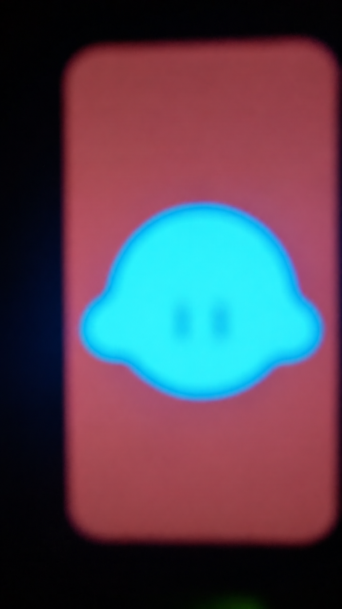
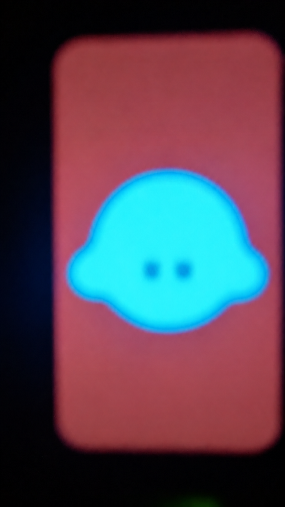
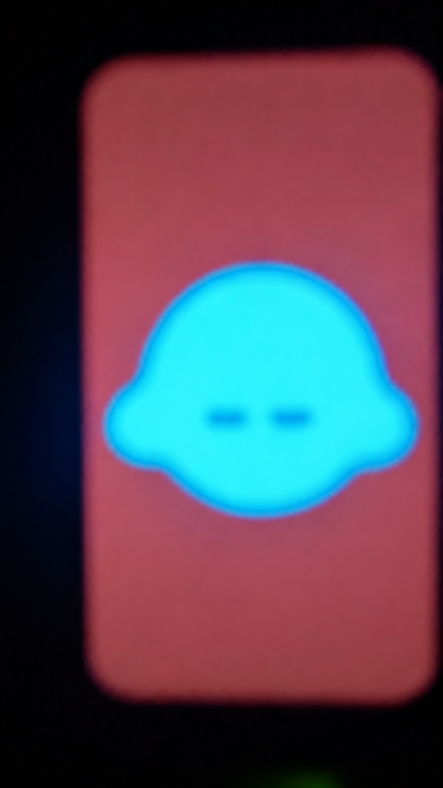

# Aubar Bot

Bot de escritorio en desarrollo, con un avatar de Kirby en una pantalla
Waveshare ESP32-S3-LCD-1.47B. La primera versión muestra el personaje centrado
y ejecuta un parpadeo automático.

El firmware funciona de forma autónoma después de cargarlo: basta con alimentar
la placa por USB. La conversación por voz y el control desde la PC son
funcionalidades previstas para próximas versiones.

## Requisitos

Esta guía está orientada a Windows y al modelo de placa indicado.

### Hardware

| Elemento | Detalle |
| --- | --- |
| **Waveshare ESP32-S3-LCD-1.47B** | ESP32-S3, pantalla ST7789 de 172 × 320 píxeles, 16 MB de flash y 8 MB de PSRAM |
| **Cable USB-C de datos** | Para alimentar la placa y transferir el programa |
| **PC con Windows y puerto USB** | Para instalar las herramientas, compilar y cargar el firmware |

Información de la placa: [documentación oficial de Waveshare](https://docs.waveshare.com/ESP32-S3-LCD-1.47B)
y [página del producto](https://www.waveshare.com/esp32-s3-lcd-1.47b.htm).

### Software

| Herramienta | Versión / uso | Enlace |
| --- | --- | --- |
| **Arduino IDE** | Versión 2; editor, compilación y carga por USB | [Descarga oficial](https://www.arduino.cc/en/software/) |
| **esp32 by Espressif Systems** | **3.3.8**, versión utilizada para validar este proyecto; incluye el compilador, Arduino y SPI para ESP32 | [Instalación oficial](https://docs.espressif.com/projects/arduino-esp32/en/latest/installing.html) |
| **Arduino CLI** — opcional | Permite compilar y cargar desde la terminal | [Documentación oficial](https://docs.arduino.cc/arduino-cli/) |
| **Python 3** — opcional | Solo para regenerar los datos del avatar al modificar su definición | [Descarga oficial](https://www.python.org/downloads/) |

Se necesita internet para descargar las herramientas y el paquete ESP32.
El firmware actual no requiere conexión a internet, microSD, micrófono,
parlantes, credenciales ni bibliotecas adicionales del gestor de bibliotecas.

## Avatar y recursos de origen

El personaje se creó y exportó con [Bible Strong Avatar Lab](https://avatars.bible-strong.app/).
La exportación original está incluida en [avatar-original/](avatar-original/),
junto con su demo web e instrucciones.

Esta versión adapta las formas, dimensiones y colores del personaje a un dibujo
frontal 2D para el ESP32. El parpadeo se implementa en el firmware.
La exportación original contiene 23 animaciones y 28 expresiones para el motor
web; esas animaciones y perspectivas todavía no están implementadas en la placa.

Los datos necesarios ya están incluidos en `avatar_data.h`. Para compilar este
proyecto no hace falta abrir Avatar Lab, volver a exportar el personaje ni
instalar React, Angular, Node.js o npm.

## Instalación y carga

### 1. Obtener el proyecto

Descargar el repositorio desde **Code > Download ZIP** en GitHub y extraerlo
en una carpeta local. También se puede clonar con Git.

Abrir los archivos desde la carpeta extraída, no desde el ZIP.

### 2. Instalar Arduino IDE y el soporte ESP32

1. Descargar e instalar [Arduino IDE 2 para Windows](https://www.arduino.cc/en/software/).
2. Abrir **Archivo > Preferencias**.
3. Agregar la siguiente dirección en **URLs adicionales de gestor de placas**,
   conservando las direcciones existentes:

   ```text
   https://espressif.github.io/arduino-esp32/package_esp32_index.json
   ```

4. Abrir el **Gestor de placas**, buscar **esp32 by Espressif Systems** e
   instalar la versión **3.3.8**.

El paquete instala las herramientas de compilación y carga necesarias.
No hay que instalar bibliotecas adicionales para esta versión.

### 3. Abrir y configurar el firmware

Abrir [firmware/KirbyPantalla/KirbyPantalla.ino](firmware/KirbyPantalla/KirbyPantalla.ino)
en Arduino IDE. Mantener juntos los cinco archivos de la carpeta
`KirbyPantalla` y conservar su nombre.

En **Herramientas > Placa > esp32**, seleccionar **ESP32S3 Dev Module**.
Configurar:

| Opción | Valor |
| --- | --- |
| Flash Size | 16MB (128Mb) |
| PSRAM | OPI PSRAM |
| USB CDC On Boot | Enabled |
| USB Mode | Hardware CDC and JTAG |
| Partition Scheme | Default (la predeterminada de esta placa) |

Las demás opciones pueden quedar por defecto. Si estas opciones no aparecen,
revisar la placa seleccionada y la versión del paquete ESP32.

### 4. Conectar y cargar

1. Conectar la placa a la PC con el cable USB-C de datos.
2. En **Herramientas > Puerto**, seleccionar el puerto que aparece al conectarla.
   El número `COM` depende de la PC.
3. Pulsar **Subir** y esperar a que termine la carga.
4. Si no arranca automáticamente, pulsar **RESET**.
5. Comprobar que el personaje aparece centrado y parpadea cada pocos segundos.

La carga reemplaza el programa anterior de la placa. No hace falta borrar
la memoria previamente. Una vez cargado, se puede cerrar Arduino IDE:
el avatar vuelve a arrancar cada vez que la placa recibe alimentación.

### Solución de problemas

| Problema | Qué revisar |
| --- | --- |
| No aparece un puerto al conectar | Usar un cable de datos y probar otro puerto USB |
| No entra en modo de carga | Mantener **BOOT**, pulsar y soltar **RESET**, y después soltar **BOOT**; volver a seleccionar el puerto |
| Puerto ocupado | Cerrar el monitor serie u otros programas que usen ese puerto |
| La compilación no encuentra los archivos del proyecto | Abrir el `.ino` desde la carpeta extraída y mantener juntos los cinco archivos de `KirbyPantalla` |
| Opciones de placa diferentes | Seleccionar **ESP32S3 Dev Module** del paquete **esp32 by Espressif Systems 3.3.8** |

## Carga desde la terminal — opcional

Requiere Arduino CLI y el paquete ESP32 instalado. La instalación con Arduino IDE
de la sección anterior es suficiente si la CLI utiliza su misma configuración.

Desde la raíz del proyecto, con `arduino-cli` disponible en PATH:

```powershell
arduino-cli board list
arduino-cli compile --fqbn "esp32:esp32:esp32s3:CDCOnBoot=cdc,FlashSize=16M,PSRAM=opi" --upload --port COM3 firmware/KirbyPantalla
```

Reemplazar `COM3` por el puerto detectado. Para compilar sin cargar, quitar
`--upload --port COM3`.

En una instalación de Arduino IDE para el usuario de Windows, la CLI incluida
puede ejecutarse desde PowerShell de esta manera:

```powershell
$kirbyCli = "$env:LOCALAPPDATA\Programs\Arduino IDE\resources\app\lib\backend\resources\arduino-cli.exe"
$kirbyConfig = "$env:USERPROFILE\.arduinoIDE\arduino-cli.yaml"
& $kirbyCli --config-file $kirbyConfig board list
& $kirbyCli --config-file $kirbyConfig compile --fqbn "esp32:esp32:esp32s3:CDCOnBoot=cdc,FlashSize=16M,PSRAM=opi" --upload --port COM3 firmware/KirbyPantalla
```

La ubicación de la CLI puede variar según la instalación. Usar Arduino IDE
es la alternativa si estas rutas no existen.

## Estructura del proyecto

```text
firmware/KirbyPantalla/
  KirbyPantalla.ino       Inicio y secuencia de parpadeo
  Display_ST7789.cpp      Controlador de la pantalla
  Display_ST7789.h        Pines y configuración de la pantalla
  avatar_data.h          Datos del avatar listos para compilar
  avatar_render.h        Dibujo del personaje
avatar-original/         Exportación del avatar y demo web
tools/                   Generador de datos del avatar
docs/images/             Imágenes de documentación y notas de edición
.gitignore               Exclusiones de Git
readme.md                Requisitos e instrucciones del proyecto
```

Los cinco archivos de `firmware/KirbyPantalla/` contienen lo necesario para
compilar y cargar esta versión. Los archivos compilados se generan localmente.

La carpeta `referencias/`, excluida de Git, contiene los ejemplos completos
descargados de Waveshare. El controlador usado está incluido en
`firmware/KirbyPantalla/`; descargar esos ejemplos es opcional.
Las cachés, los temporales y las dependencias locales también se excluyen de Git.

## Modificar los datos del avatar — opcional

Para regenerar `avatar_data.h` desde
`avatar-original/kirby.avatar.json`, instalar Python 3 y ejecutar desde
la raíz del proyecto:

```powershell
python tools/generate_avatar_data.py
```

El generador usa la biblioteca estándar de Python. Después de regenerar los
datos, compilar y cargar nuevamente el firmware. El generador adapta la
geometría frontal y la expresión neutral; no convierte el motor de animaciones web.

## Imágenes del prototipo

 |


## Validación

Versión compilada con **esp32 by Espressif Systems 3.3.8** y cargada por USB
en una **Waveshare ESP32-S3-LCD-1.47B**, el **26 de octubre de 2026**.
La herramienta verificó los datos escritos y se confirmó visualmente
que el avatar aparecía en la pantalla.

## Créditos y documentación

- Avatar: [Bible Strong Avatar Lab](https://avatars.bible-strong.app/).
- Hardware: [Waveshare ESP32-S3-LCD-1.47B](https://docs.waveshare.com/ESP32-S3-LCD-1.47B).
- Configuración y ejemplos: [guía de Arduino de Waveshare](https://docs.waveshare.com/ESP32-S3-LCD-1.47B/Arduino).
- Controlador de pantalla: adaptado del ejemplo **LCD_Image** del
  [paquete oficial de ejemplos de Waveshare](https://files.waveshare.com/wiki/ESP32-S3-LCD-1.47B/ESP32-S3-LCD-1.47B-Demo.zip).
  Se ajustó SPI a 40 MHz y se eliminó un buffer de lectura innecesario.
- Entorno: [Arduino](https://www.arduino.cc/en/software/) y
  [Arduino ESP32 de Espressif](https://docs.espressif.com/projects/arduino-esp32/en/latest/).