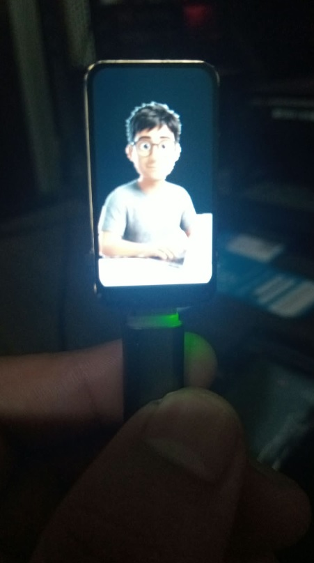
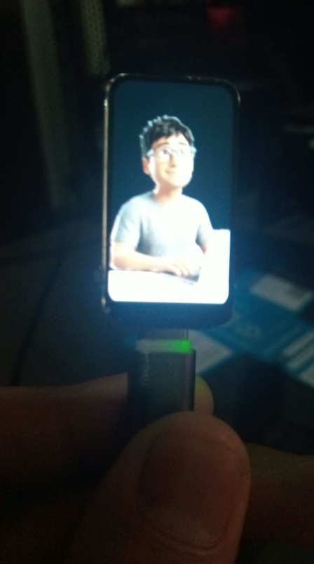
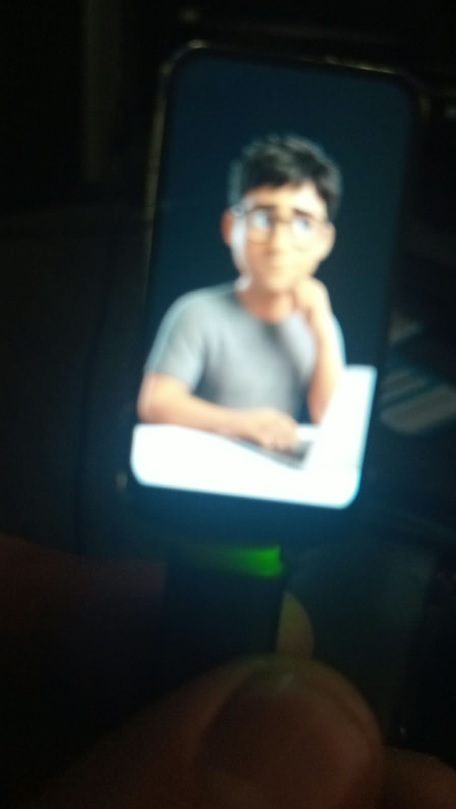
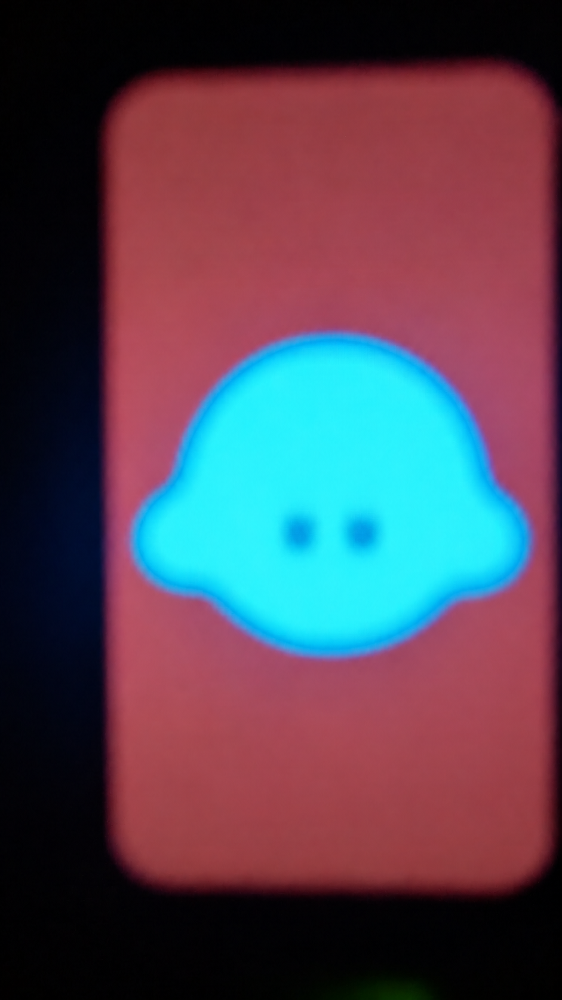
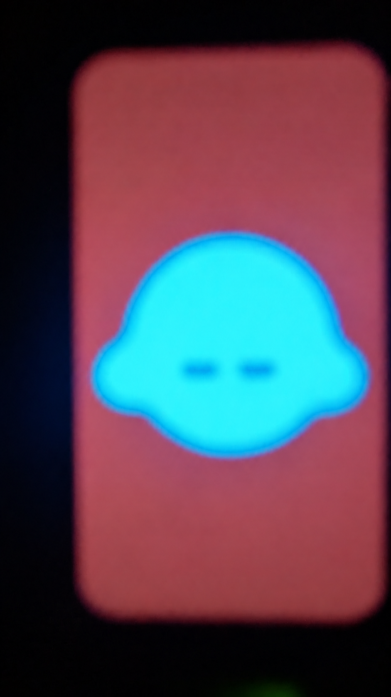
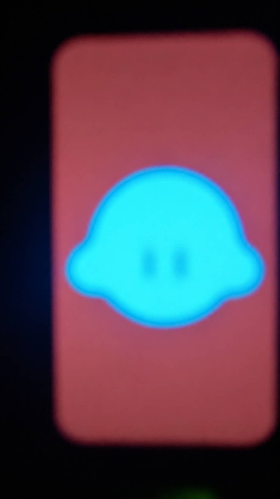

# Aubar Bot

**Tu asistente de escritorio, con el retrato animado de Nahuel.**

El personaje actual usa imágenes y videos del retrato de Nahuel, preparados para
la pantalla Waveshare ESP32-S3-LCD-1.47B. Acompaña las respuestas con miradas,
gestos y movimientos de boca.

  

Fotografías del personaje actual funcionando en el dispositivo.

## Evolución del personaje

Aubar comenzó con un avatar geométrico inspirado en Kirby. Después evolucionó
al retrato animado de Nahuel que aparece arriba. Estas imágenes conservan la
historia del prototipo; muestran la versión anterior, no el personaje actual.

  

El avatar geométrico original proviene de [Bible Strong Avatar Lab](https://avatars.bible-strong.app/).

## Qué hace Aubar

Asistente de escritorio con ESP32-S3, retrato animado, reconocimiento local con
Whisper small y voz Kokoro/Onyx. Integra conversaciones con Groq, consultas al
portfolio, YouTube y el puente de WhatsApp.

## Tecnologías y propósito

| Tecnología | Para qué se usa |
| --- | --- |
| Python y Tkinter | Panel de escritorio, micrófono e integraciones. |
| Whisper small | Reconocimiento local de voz en CPU; reemplaza a Vosk. |
| Kokoro/Onyx (`am_onyx`) | Voz local; reemplaza a la voz Dora. |
| Groq | Generación del texto de las respuestas, mediante internet y una clave propia. |
| Aubar Director local | Selección de gestos y ajustes de actuación sin una segunda consulta a Groq. |
| C++ y Arduino ESP32 | Pantalla, animaciones y comunicación USB del retrato. |
| Node.js | Puente opcional de WhatsApp. |

La boca acompaña el audio; no representa una sincronización exacta de cada
fonema. El director local es la opción predeterminada y no reemplaza el modelo
de conversación de Groq. YouTube, portfolio y WhatsApp conservan sus controles
locales: una elección de gesto no ejecuta una función.

## Requisitos

Esta guía está orientada a **Windows y PowerShell**. No se presenta como una
instalación verificada en Linux o macOS.

- Git y Python 3.11 o superior con `pip`, `venv` y Tkinter.
- Micrófono para hablar y parlantes o auriculares para escuchar.
- Internet para la primera descarga de dependencias y modelos. Los modelos
  ocupan cientos de MB adicionales al repositorio.
- Una clave propia de Groq para las conversaciones con IA.
- Para el retrato físico: **Waveshare ESP32-S3-LCD-1.47B**, pantalla de 172 × 320,
  flash de 16 MB, PSRAM de 8 MB y cable USB-C de datos.
- Node.js 24 solamente si vas a usar WhatsApp.

**Podés probar el chat y la voz del panel sin tener la placa.** La placa agrega
el retrato físico. Una vez cargado el firmware puede animarse alimentada por USB;
el micrófono, la conversación y la voz se ejecutan en la PC.

## Instalación desde cero

Desde una carpeta donde quieras guardar el proyecto:

```powershell
git clone https://github.com/aubarcito48/aubar-bot.git
cd aubar-bot
python --version
```

Si `python` no está disponible, comprobá `py --version`; el lanzador acepta ambos.
Solo si todavía no existe `.env`, crealo con:

```powershell
Copy-Item .env.example .env
```

Abrí `.env` en tu editor y completá `GROQ_API_KEY` con tu clave. Conservá los
demás valores predeterminados para empezar. Las claves y sesiones son privadas:
no las incluyas en capturas ni las subas a GitHub.

## Iniciar

Desde la raíz del proyecto, con Python 3.11 o superior:

```powershell
.\tools\start_control.ps1
```

El lanzador prepara el entorno y los modelos cuando faltan. Las credenciales se
configuran en `.env` a partir de `.env.example` y permanecen fuera de Git.

La primera ejecución crea `.venv`, instala las dependencias y prepara
Whisper, Kokoro y el codificador de Aubar Director. Puede tardar por las descargas.
Las siguientes reutilizan esos
archivos. Si PowerShell bloquea el script, revisá la política de ejecución de tu
equipo; no hace falta cambiar la política de toda la máquina para este proyecto.

`AUBAR_DIRECTOR=local` selecciona la actuación local. Los archivos anteriores que
indican `groq` también se interpretan como `local`: Groq genera solo el contenido.
Si el director no puede elegir una actuación con confianza, conserva el texto
y usa un gesto neutral. Un pedido explícito de sonreír usa la sonrisa suave;
las risas y la alegría intensa conservan sus gestos propios.

Podés pedir la actuación antes o después del verbo, por ejemplo
«Aubar, sospechoso, decime: hola Nahuel» o «decime con sospecha: hola Nahuel».
También reconoce pedidos explícitos de tristeza, enojo, risa, sorpresa, miedo,
timidez, curiosidad, confusión, orgullo, aburrimiento y celebración. El texto
entre comillas se trata como las palabras a decir, no como instrucciones de gesto.

### Comprobar el panel

1. En **IA**, escribí una pregunta y pulsá **Enviar**. Con una clave válida y
   conexión debe aparecer la respuesta.
2. Activá la voz o usá **Escuchar respuesta** para comprobar el audio.
3. En **Micrófono**, elegí la entrada y usá **Probar micrófono**.
4. Esperá **Reconocimiento listo** y activá escucha automática o mantené pulsado
   el botón para hablar. Podés decir «cómo estás» sin anteponer «Aubar».
5. Si ya cargaste el firmware, conectá el puerto de la placa en **Dispositivo**
   y probá una expresión como «contento».

La escucha se pausa mientras Aubar habla para evitar reconocerse a sí mismo.
La voz selecciona español o inglés mediante una heurística; las frases mezcladas
no cambian de idioma palabra por palabra.

### Qué necesita internet

Después de preparar los modelos, el reconocimiento, la voz y el control local
del retrato pueden funcionar sin internet. Groq, el portfolio, YouTube y WhatsApp
requieren conexión. Para tu propio portfolio, configurá una API compatible en
`AUBAR_PORTFOLIO_API_URL`; el ejemplo apunta al portfolio del autor.

## WhatsApp opcional

El puente se limita a contactos autorizados y necesita una cuenta para vincular.
No es un servicio público listo para responder a cualquier número.

```powershell
cd integrations\whatsapp-bot
npm ci
```

Solo si no existe el `.env` de esta carpeta, crealo con
`Copy-Item .env.example .env`. Completá `TEST_CONTACTS` con números internacionales,
solo dígitos, separados por comas. El contacto de prueba debe ser distinto del
número vinculado al bot. Revisá `PORTFOLIO_API_URL`: para un uso propio configurá
tu servicio compatible; el ejemplo utiliza la API del autor.

Para habilitar el control privado y las notificaciones desde el panel, volvé a
la raíz con `cd ../..` y ejecutá:

```powershell
.\.venv\Scripts\python.exe tools\integrations\configure_whatsapp_bridge.py
```

El script configura el token compartido sin mostrarlo. En otra terminal, desde
la raíz, iniciá el puente:

```powershell
cd integrations\whatsapp-bot
npm start
```

Seguí el QR privado de la terminal para vincular WhatsApp y reiniciá el panel
para recargar su configuración. Comprobá el estado de la integración. No compartas
el QR ni `.data`, que conserva la sesión. Los envíos desde el panel requieren
una orden explícita y los contactos permitidos.

## Preparar una placa nueva

Este paso carga firmware y **reemplaza el programa de la placa**. No hace falta
repetirlo al abrir el panel. Usá el modelo Waveshare indicado; otras placas
pueden tener pines, memoria o pantalla diferentes.

Con Arduino CLI instalado y disponible en `PATH`, desde la raíz:

```powershell
arduino-cli core update-index --additional-urls https://espressif.github.io/arduino-esp32/package_esp32_index.json
arduino-cli core install esp32:esp32@3.3.8 --additional-urls https://espressif.github.io/arduino-esp32/package_esp32_index.json
.\.venv\Scripts\python.exe tools\avatar\generate_portrait_firmware.py --refresh-path
arduino-cli board list
```

El comando de Python actualiza la ruta del banco incluido sin regenerar cuadros.
Compilá con flash de 16 MB, PSRAM OPI y la partición de aplicación de 12 MiB:

```powershell
arduino-cli compile --fqbn "esp32:esp32:esp32s3:CDCOnBoot=cdc,FlashSize=16M,PSRAM=opi" --jobs 1 --build-property upload.maximum_size=12582912 --build-path build/portrait --output-dir build/portrait-output firmware/KirbyPantalla
```

Desconectá el panel del puerto serie y cerrá otros monitores serie. Reemplazá
`COM3` por el puerto mostrado por `board list`:

```powershell
arduino-cli upload --fqbn "esp32:esp32:esp32s3:CDCOnBoot=cdc,FlashSize=16M,PSRAM=opi" --port COM3 --input-dir build/portrait-output firmware/KirbyPantalla
```

Tras reiniciar debe aparecer el retrato. Conservá el `partitions.csv` incluido;
una partición predeterminada pequeña no alcanza para el banco de imágenes.

## Problemas frecuentes

| Problema | Qué revisar |
| --- | --- |
| No abre el panel | Ejecutá el lanzador desde PowerShell para ver el error. Comprobá Python, Tkinter y conexión para la primera preparación. |
| No reconoce la voz | Esperá la preparación de Whisper, elegí el micrófono y revisá los permisos de aplicaciones de escritorio en Windows. |
| No se escucha | Revisá el dispositivo de salida, volumen y activación de voz en el panel. |
| Groq no responde | Revisá tu clave, conexión y límites del proveedor. No compartas `.env` al pedir ayuda. |
| La placa no aparece | Usá un cable de datos y comprobá que otro programa no tenga ocupado el puerto. |
| Falla `.incbin` o falta `portrait_asset_path.h` | Ejecutá `generate_portrait_firmware.py --refresh-path` desde la raíz. |
| El programa no entra en memoria | Conservá `partitions.csv`, flash de 16 MB y `upload.maximum_size=12582912`. |
| WhatsApp no conecta | Revisá contactos autorizados, vinculación y que el puente siga ejecutándose. |

## Organización

- `pc/aubar_control/ui/`: panel de escritorio.
- `pc/aubar_control/config/`: configuración; `paths.py` fija la raíz del proyecto.
- `pc/aubar_control/models/avatar/`: catálogo y respuestas del avatar.
- `pc/aubar_control/services/`: audio, reconocimiento, voz y asistente/director.
- `pc/aubar_control/device/`: protocolo y conexión USB.
- `pc/aubar_control/integrations/`: portfolio, WhatsApp y YouTube.
- `firmware/KirbyPantalla/src/`: avatar, animaciones, retrato y USB. El sketch,
  el controlador de pantalla y el banco binario conservan su ubicación de compilación.
- `integrations/whatsapp-bot/src/`: configuración, servicios y almacenamiento del puente.
- `assets/`: fuentes del retrato, catálogo original y fotografías del dispositivo.
- `tools/`: instalación, generación de recursos y configuración de integraciones.
- `models/`: modelos locales, excluidos de Git.

`KirbyPantalla` conserva el nombre histórico del sketch; el personaje que muestra
el firmware actual es el retrato de Nahuel.

El firmware se abre con `firmware/KirbyPantalla/KirbyPantalla.ino`. Al mover el
checkout se actualiza la ruta del banco de imágenes, sin regenerarlo:

```powershell
.\.venv\Scripts\python.exe tools\avatar\generate_portrait_firmware.py --refresh-path
```

Los recursos y modelos conservan las licencias incluidas en sus archivos y descargas.
