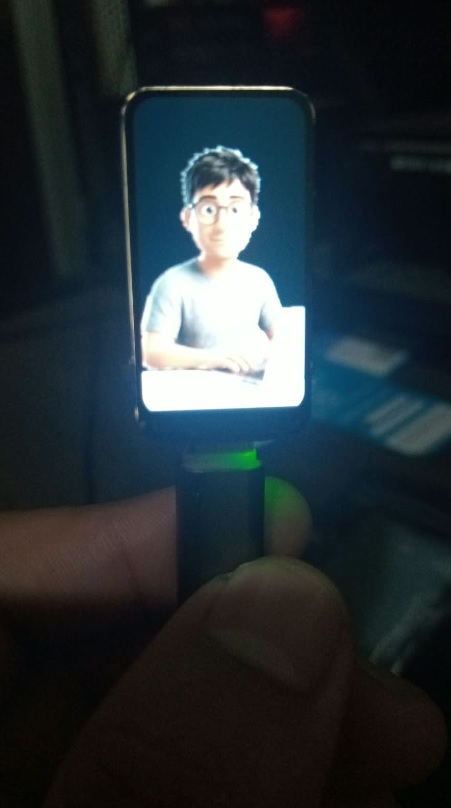
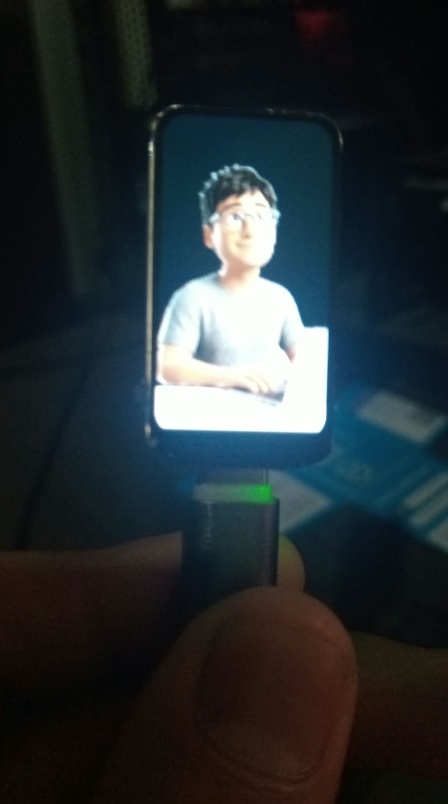
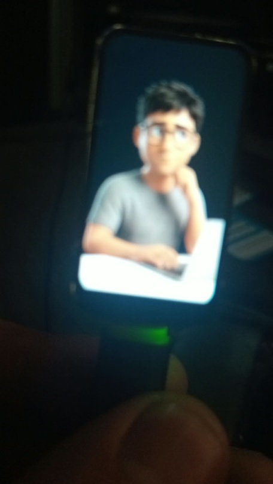
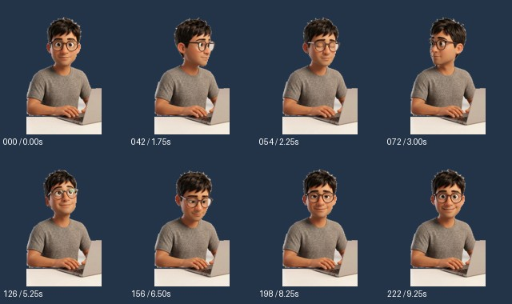
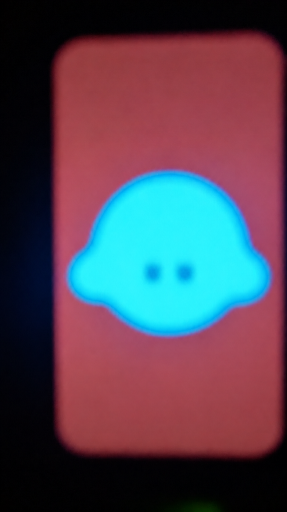
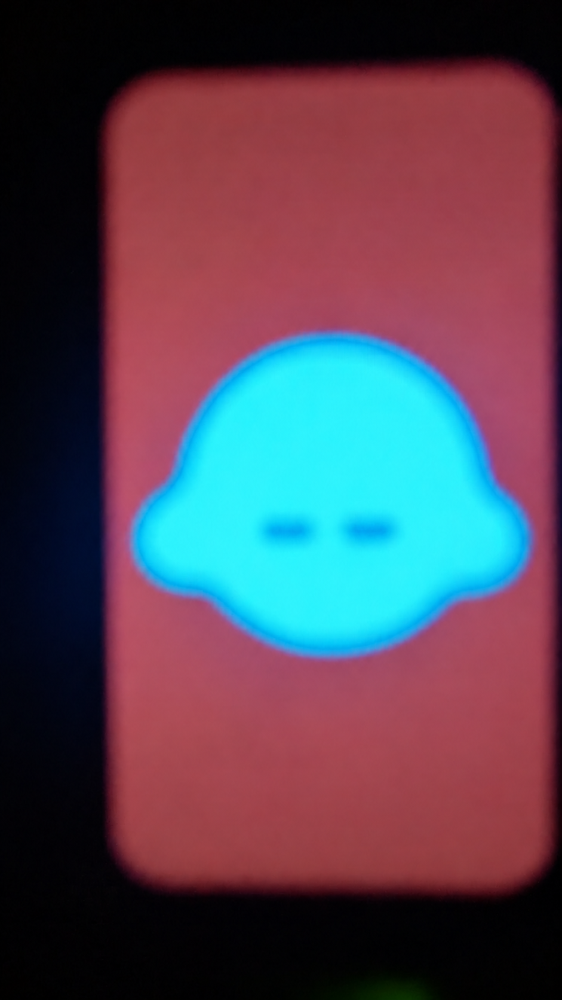
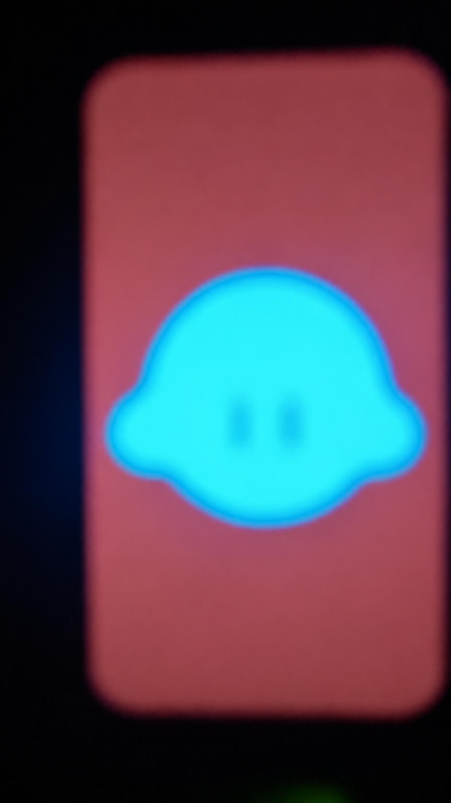

# Aubar Bot

Bot de escritorio en desarrollo, con el retrato animado de Nahuel en una pantalla
Waveshare ESP32-S3-LCD-1.47B. Usa los cuadros de dos videos y seis poses estáticas,
con miradas y control por voz desde el micrófono de la PC.

Se mantienen los 28 identificadores de expresión y las 23 animaciones del panel.
Las emociones sin imagen propia usan equivalencias temporales, por lo que todavía
no son 28 expresiones visualmente distintas. Ver [el firmware del retrato](newAUBAR/tramo-01-base-miradas/guia/FIRMWARE_AVATAR.md)
para los recursos, las equivalencias, la compilación y la verificación en placa.

El firmware funciona de forma autónoma después de cargarlo: basta con alimentar
la placa por USB. Para controlarlo por voz se utiliza el panel de la PC;
también permite conversar con Groq, escuchar las respuestas con la voz local
Onyx y abrir, buscar y reproducir videos de YouTube en el navegador.



Retrato nuevo funcionando en la placa, fotografiado el 13 de noviembre de 2026.

## Usar el panel de PC

Con Python 3.11 o superior instalado y el firmware cargado, ejecutar desde
PowerShell en la raíz del proyecto:

```powershell
.\tools\start_control.ps1
```

El lanzador prepara el entorno, las dependencias y los modelos de voz. La primera
ejecución necesita internet para descargarlos; el modelo completo de español
ocupa unos 1,4 GB. Esperar **Reconocimiento listo** antes de hablar: la carga
inicial del modelo puede tardar unos 25 segundos.

En **Dispositivo**, conectar el puerto del ESP32. En **Micrófono**, elegir la
entrada y activar la escucha automática, o mantener pulsado el botón para hablar.
Los dos modos aceptan comandos y preguntas **sin decir «Aubar»**. El nombre
es opcional. **Probar micrófono** permite escuchar una muestra de la entrada
sin ejecutar comandos.

Para conversar, copiar `.env.example` a `.env` si todavía no existe ese archivo,
completar `GROQ_API_KEY` y recargar la configuración en **IA**. La clave permanece
en el archivo local, excluido de Git. Groq y YouTube necesitan internet; el
reconocimiento, la voz Onyx y los comandos del avatar funcionan localmente.

## Conversación y YouTube

Se puede decir **«contame algo interesante»** o **«cómo estás»** directamente.
Las respuestas conservan el contexto de la conversación, se leen con Onyx si
**Activar voz** está marcado y acompañan al avatar con una expresión o animación.
**Nueva conversación** borra el contexto; **Cancelar** interrumpe el turno pendiente.
La escucha se pausa mientras Aubar responde y vuelve si la automática sigue activa.

En la pestaña **IA** se puede escribir un mensaje y pulsar **Enviar**. Activar
**Voz en el chat** mediante la casilla **Activar voz en el chat** para leer
automáticamente las próximas respuestas. **Escuchar respuesta** reproduce la
última respuesta recibida y **Detener voz** interrumpe la lectura. El chat y la
voz pueden usarse sin conectar el ESP32; la placa agrega la expresión visual.

La voz elegida sigue siendo **`am_onyx`**. Usa fonética de español latinoamericano
o inglés según las palabras del texto, con velocidad base 1.08 para un ritmo
ligeramente más ágil. La selección de idioma es una heurística: frases cortas
o ambiguas vuelven al español y los textos mezclados usan un solo idioma.
El chat responde por defecto con voseo argentino, o en inglés si se lo pedís.
Esto aproxima la forma de hablar; no es una voz entrenada con acento cordobés
ni ofrece control emocional. Para cargar el cambio, cerrar y volver a abrir el panel.

Con el firmware de habla, el retrato mueve la boca durante la reproducción de
Onyx: funciona en la prueba de voz, las respuestas del micrófono y el chat leído.
La secuencia continúa entre palabras y vuelve a la expresión anterior al terminar
o detener el audio. Es animación acompañando la voz, sin sincronización exacta
de cada fonema. [Preparación y prueba del habla](newAUBAR/tramo-04-hablar/guia/HABLA.md).

El [tramo 02](newAUBAR/tramo-02-emociones/guia/INTEGRACION.md) agrega movimientos
propios para sospecha, confusión, enojo, tristeza, miedo y timidez.
El [tramo 03](newAUBAR/tramo-03-gestos-restantes/guia/INTEGRACION.md) agrega
aburrimiento, sorpresa, orgullo, risa y variantes de alegría, juego y celebración.

| Acción | Ejemplo de voz |
| --- | --- |
| Abrir YouTube | «abrí YouTube» |
| Mostrar resultados de búsqueda | «buscá videos de gatos en YouTube» |
| Buscar y abrir el primer video para reproducirlo | «poné videos de gatos en YouTube» |
| Pedir la reproducción con otro verbo | «reproducí música relajante en YouTube» |
| Abrir, buscar y reproducir con una sola frase | «abrí YouTube y buscá videos de gatos y reproducilo» |

Las acciones de YouTube se ejecutan en el navegador predeterminado de la PC y
no necesitan Groq. «Buscá» muestra los resultados; «poné» y «reproducí» abren el
primer video con reproducción automática, sujeta a los controles del navegador
y de YouTube.

## Comandos de voz aislados

Para usar la voz, abrir el [panel de PC](#usar-el-panel-de-pc), conectar el
ESP32 y seleccionar el micrófono. En **escucha automática**, activar la casilla,
esperar la calibración y decir **el comando directamente**. Una pausa de
**0,8 segundos** termina la frase. En captura manual, esperar **Escuchando**,
hablar y soltar el botón para terminar. Ninguno de los modos exige «Aubar».

Se ignoran mayúsculas, tildes y puntuación. El panel muestra lo reconocido y
la confirmación del ESP32. Los siguientes comandos seleccionan una sola acción.

### Expresiones fijas — 28

| Expresión | Comando de voz |
| --- | --- |
| Neutral | «neutral» |
| Contento | «contento» |
| Sorprendido | «sorprendido» |
| Dormido | «dormido» |
| Enojado | «enojado» |
| Mirada lateral arriba | «mirada lateral arriba» |
| Mirada abajo | «mirada abajo» |
| Escéptico derecha | «escéptico derecha» |
| Atento pequeño | «atento pequeño» |
| Mirada amplia abajo | «mirada amplia abajo» |
| Sorpresa izquierda | «sorpresa izquierda» |
| Somnoliento | «somnoliento» |
| Curioso izquierda | «curioso izquierda» |
| Asimétrico abajo derecha | «asimétrico abajo derecha» |
| Atento izquierda | «atento izquierda» |
| Alegre abajo derecha | «alegre abajo derecha» |
| Escéptico izquierda | «escéptico izquierda» |
| Mirada derecha | «mirada derecha» |
| Enojado izquierda | «expresión enojado izquierda» |
| Juguetón derecha | «juguetón derecha» |
| Asimétrico arriba izquierda | «asimétrico arriba izquierda» |
| Mirada suave abajo | «mirada suave abajo» |
| Mirada amplia abajo izquierda | «expresión mirada amplia abajo izquierda» |
| Adormilado | «adormilado» |
| Sospechoso derecha | «sospechoso derecha» |
| Tímido | «tímido» |
| Cejas enojadas | «cejas enojadas» |
| Inquieto izquierda | «inquieto izquierda» |

También se aceptan **«dormite»**, **«duerme»** y **«a dormir»**
para la expresión dormida. Para contento, usar **«contento»**.
Los nombres se dicen directamente, como **«mirada lateral arriba»** o **«tímido»**.
Solo las poses **Enojado izquierda** y **Mirada amplia abajo izquierda** llevan
«expresión» para distinguirlas de un comando que combina otra expresión con mirada.

### Animaciones del catálogo — 23

| Animación | Comando de voz |
| --- | --- |
| Dormir | «dormir» |
| Despertar | «despertar» |
| Reposo | «reposo» |
| Escuchar | «escuchar» |
| Pensar | «pensar» |
| Buscar | «buscar» |
| Trabajar | «trabajar» |
| Entusiasmarse | «entusiasmarse» |
| Aburrirse | «aburrirse» |
| Sospechar | «sospechar» |
| Enojarse | «enojarse» |
| Adormecerse | «adormecerse» |
| Alegría | «alegría» |
| Curiosear | «curiosear» |
| Confundirse | «confundirse» |
| Sorprenderse | «sorprenderse» |
| Orgullo | «orgullo» |
| Timidez | «timidez» |
| Tristeza | «tristeza» |
| Reír | «reír» |
| Asustarse | «asustarse» |
| Jugar | «jugar» |
| Celebrar | «celebrar» |

**«dormido»** elige una expresión y **«dormir»** selecciona la animación
del catálogo. En el retrato actual ambas muestran la imagen dormida; el video
de sueño queda pendiente de nuevos recursos.

### Miradas y modos

| Acción | Comando de voz |
| --- | --- |
| Mirar a la izquierda | «izquierda» o «mirá a la izquierda» |
| Mirar al centro | «centro» o «mirá al centro» |
| Mirar a la derecha | «derecha» o «mirá a la derecha» |
| Recorrer automáticamente todas las animaciones | «modo automático» |
| Detener la secuencia en la expresión actual | «modo manual» |

Una mirada aislada conserva la animación que se esté reproduciendo.
El modo automático elimina la mirada manual y recorre el catálogo con sus
correspondencias actuales de retrato.

## Comandos de voz combinados

Combinar **una expresión o una animación** con **izquierda, centro o derecha**.
Hay **153 combinaciones**: 28 expresiones × 3 miradas y 23 animaciones × 3 miradas.

Ejemplos: **«enojado derecha»**, **«celebrar izquierda»** y
**«pensar centro»**. También se acepta **«enojado mirando a la
derecha»** o **«celebrar y izquierda»**.

La combinación se aplica en una sola orden y la mirada se mantiene durante
los pasos de la animación y las selecciones siguientes. **«centro»**
la centra; **«modo automático»** elimina la orientación manual.
En el retrato actual, izquierda/derecha tienen prioridad visual sobre la emoción.
Todavía no hay poses dormidas o enojadas para cada dirección; se usa el giro
disponible del video. Las 153 combinaciones son comandos compatibles, no 153
animaciones visuales distintas.

Los combinados requieren el firmware con **protocolo USB v4**. Si el nombre de
la expresión ya incluye una dirección, agregar **«mirando»** para indicar la
orientación deseada: **«mirada derecha mirando a la izquierda»**.

<details>
<summary>Lista completa: expresiones con mirada — 84 combinaciones</summary>

| Expresión | Comandos combinados |
| --- | --- |
| Neutral | «neutral izquierda»<br>«neutral centro»<br>«neutral derecha» |
| Contento | «contento izquierda»<br>«contento centro»<br>«contento derecha» |
| Sorprendido | «sorprendido izquierda»<br>«sorprendido centro»<br>«sorprendido derecha» |
| Dormido | «dormido izquierda»<br>«dormido centro»<br>«dormido derecha» |
| Enojado | «enojado izquierda»<br>«enojado centro»<br>«enojado derecha» |
| Mirada lateral arriba | «mirada lateral arriba mirando a la izquierda»<br>«mirada lateral arriba mirando al centro»<br>«mirada lateral arriba mirando a la derecha» |
| Mirada abajo | «mirada abajo mirando a la izquierda»<br>«mirada abajo mirando al centro»<br>«mirada abajo mirando a la derecha» |
| Escéptico derecha | «escéptico derecha mirando a la izquierda»<br>«escéptico derecha mirando al centro»<br>«escéptico derecha mirando a la derecha» |
| Atento pequeño | «atento pequeño mirando a la izquierda»<br>«atento pequeño mirando al centro»<br>«atento pequeño mirando a la derecha» |
| Mirada amplia abajo | «mirada amplia abajo mirando a la izquierda»<br>«mirada amplia abajo mirando al centro»<br>«mirada amplia abajo mirando a la derecha» |
| Sorpresa izquierda | «sorpresa izquierda mirando a la izquierda»<br>«sorpresa izquierda mirando al centro»<br>«sorpresa izquierda mirando a la derecha» |
| Somnoliento | «somnoliento mirando a la izquierda»<br>«somnoliento mirando al centro»<br>«somnoliento mirando a la derecha» |
| Curioso izquierda | «curioso izquierda mirando a la izquierda»<br>«curioso izquierda mirando al centro»<br>«curioso izquierda mirando a la derecha» |
| Asimétrico abajo derecha | «asimétrico abajo derecha mirando a la izquierda»<br>«asimétrico abajo derecha mirando al centro»<br>«asimétrico abajo derecha mirando a la derecha» |
| Atento izquierda | «atento izquierda mirando a la izquierda»<br>«atento izquierda mirando al centro»<br>«atento izquierda mirando a la derecha» |
| Alegre abajo derecha | «alegre abajo derecha mirando a la izquierda»<br>«alegre abajo derecha mirando al centro»<br>«alegre abajo derecha mirando a la derecha» |
| Escéptico izquierda | «escéptico izquierda mirando a la izquierda»<br>«escéptico izquierda mirando al centro»<br>«escéptico izquierda mirando a la derecha» |
| Mirada derecha | «mirada derecha mirando a la izquierda»<br>«mirada derecha mirando al centro»<br>«mirada derecha mirando a la derecha» |
| Enojado izquierda | «enojado izquierda mirando a la izquierda»<br>«enojado izquierda mirando al centro»<br>«enojado izquierda mirando a la derecha» |
| Juguetón derecha | «juguetón derecha mirando a la izquierda»<br>«juguetón derecha mirando al centro»<br>«juguetón derecha mirando a la derecha» |
| Asimétrico arriba izquierda | «asimétrico arriba izquierda mirando a la izquierda»<br>«asimétrico arriba izquierda mirando al centro»<br>«asimétrico arriba izquierda mirando a la derecha» |
| Mirada suave abajo | «mirada suave abajo mirando a la izquierda»<br>«mirada suave abajo mirando al centro»<br>«mirada suave abajo mirando a la derecha» |
| Mirada amplia abajo izquierda | «mirada amplia abajo izquierda mirando a la izquierda»<br>«mirada amplia abajo izquierda mirando al centro»<br>«mirada amplia abajo izquierda mirando a la derecha» |
| Adormilado | «adormilado mirando a la izquierda»<br>«adormilado mirando al centro»<br>«adormilado mirando a la derecha» |
| Sospechoso derecha | «sospechoso derecha mirando a la izquierda»<br>«sospechoso derecha mirando al centro»<br>«sospechoso derecha mirando a la derecha» |
| Tímido | «tímido mirando a la izquierda»<br>«tímido mirando al centro»<br>«tímido mirando a la derecha» |
| Cejas enojadas | «cejas enojadas mirando a la izquierda»<br>«cejas enojadas mirando al centro»<br>«cejas enojadas mirando a la derecha» |
| Inquieto izquierda | «inquieto izquierda mirando a la izquierda»<br>«inquieto izquierda mirando al centro»<br>«inquieto izquierda mirando a la derecha» |

</details>

<details>
<summary>Lista completa: animaciones con mirada — 69 combinaciones</summary>

| Animación | Comandos combinados |
| --- | --- |
| Dormir | «dormir izquierda»<br>«dormir centro»<br>«dormir derecha» |
| Despertar | «despertar izquierda»<br>«despertar centro»<br>«despertar derecha» |
| Reposo | «reposo izquierda»<br>«reposo centro»<br>«reposo derecha» |
| Escuchar | «escuchar izquierda»<br>«escuchar centro»<br>«escuchar derecha» |
| Pensar | «pensar izquierda»<br>«pensar centro»<br>«pensar derecha» |
| Buscar | «buscar izquierda»<br>«buscar centro»<br>«buscar derecha» |
| Trabajar | «trabajar izquierda»<br>«trabajar centro»<br>«trabajar derecha» |
| Entusiasmarse | «entusiasmarse izquierda»<br>«entusiasmarse centro»<br>«entusiasmarse derecha» |
| Aburrirse | «aburrirse izquierda»<br>«aburrirse centro»<br>«aburrirse derecha» |
| Sospechar | «sospechar izquierda»<br>«sospechar centro»<br>«sospechar derecha» |
| Enojarse | «enojarse izquierda»<br>«enojarse centro»<br>«enojarse derecha» |
| Adormecerse | «adormecerse izquierda»<br>«adormecerse centro»<br>«adormecerse derecha» |
| Alegría | «alegría izquierda»<br>«alegría centro»<br>«alegría derecha» |
| Curiosear | «curiosear izquierda»<br>«curiosear centro»<br>«curiosear derecha» |
| Confundirse | «confundirse izquierda»<br>«confundirse centro»<br>«confundirse derecha» |
| Sorprenderse | «sorprenderse izquierda»<br>«sorprenderse centro»<br>«sorprenderse derecha» |
| Orgullo | «orgullo izquierda»<br>«orgullo centro»<br>«orgullo derecha» |
| Timidez | «timidez izquierda»<br>«timidez centro»<br>«timidez derecha» |
| Tristeza | «tristeza izquierda»<br>«tristeza centro»<br>«tristeza derecha» |
| Reír | «reír izquierda»<br>«reír centro»<br>«reír derecha» |
| Asustarse | «asustarse izquierda»<br>«asustarse centro»<br>«asustarse derecha» |
| Jugar | «jugar izquierda»<br>«jugar centro»<br>«jugar derecha» |
| Celebrar | «celebrar izquierda»<br>«celebrar centro»<br>«celebrar derecha» |

</details>

El catálogo también está disponible en la pestaña **Catálogo** del panel.

## Requisitos

La instalación está orientada a Windows y a la **Waveshare ESP32-S3-LCD-1.47B**:
ESP32-S3, pantalla ST7789 de 172 × 320, flash de 16 MB y PSRAM de 8 MB. Se necesita
un cable USB-C de datos.

| Herramienta | Uso |
| --- | --- |
| [Arduino CLI](https://docs.arduino.cc/arduino-cli/installation/) | Compilar y cargar el firmware desde PowerShell. |
| [Core ESP32 de Espressif](https://docs.espressif.com/projects/arduino-esp32/en/latest/installing.html), versión **3.3.8** | Herramientas y bibliotecas utilizadas en la placa validada. |
| [Python 3.11 o superior](https://www.python.org/downloads/) | Panel de PC y actualización de la ruta local del banco de imágenes. |

El firmware ya cargado funciona sin internet ni microSD. El micrófono, los
parlantes y las credenciales de IA se utilizan desde el panel de PC.

## Avatar y recursos de origen

El avatar actual es el retrato de Nahuel, preparado a partir de imágenes y videos
generados con Gemini. Tiene dos videos de 240 cuadros y seis poses estáticas.
El banco comprimido `portrait_assets.dat` está incluido en el repositorio.


El avatar geométrico anterior proviene de [Bible Strong Avatar Lab](https://avatars.bible-strong.app/).
Su exportación y el renderizador se conservan como referencia histórica.

Consultar [la preparación y las equivalencias del retrato](newAUBAR/tramo-01-base-miradas/guia/FIRMWARE_AVATAR.md)
para conocer qué recursos representa cada comando y cómo incorporar nuevos videos.

## Instalación y carga con Arduino CLI

Ejecutar los comandos desde la raíz de `botbar`, donde está este README.
Descargar y extraer el ZIP del repositorio o clonarlo con Git antes de continuar.
Mantener juntos los archivos de `firmware/KirbyPantalla`.

### 1. Preparar Arduino CLI

Instalar [Arduino CLI para Windows](https://docs.arduino.cc/arduino-cli/installation/)
y dejar el ejecutable disponible en PATH. En PowerShell:

```powershell
$aubarCli = "arduino-cli"
$aubarCliArgs = @()
& $aubarCli @aubarCliArgs version
```

Si ya se dispone de Arduino IDE 2, se puede usar su CLI incluida en lugar de
instalar otra. En ese caso, reemplazar las dos primeras variables por estas
rutas habituales y continuar con los mismos comandos:

```powershell
$aubarCli = "$env:LOCALAPPDATA/Programs/Arduino IDE/resources/app/lib/backend/resources/arduino-cli.exe"
$aubarCliArgs = @("--config-file", "$env:USERPROFILE/.arduinoIDE/arduino-cli.yaml")
& $aubarCli @aubarCliArgs version
```

Las rutas pueden variar según la instalación. La compilación de esta guía se
realiza por CLI en ambos casos.

### 2. Instalar el soporte ESP32

En una instalación nueva, actualizar el índice e instalar la versión validada:

```powershell
& $aubarCli @aubarCliArgs core update-index --additional-urls https://espressif.github.io/arduino-esp32/package_esp32_index.json
& $aubarCli @aubarCliArgs core install esp32:esp32@3.3.8 --additional-urls https://espressif.github.io/arduino-esp32/package_esp32_index.json
```

Si esa versión ya está instalada y accesible con la configuración elegida,
se puede pasar al siguiente paso. No hacen falta bibliotecas adicionales del
gestor de bibliotecas para el firmware.

### 3. Preparar la ruta del banco de imágenes

Después de clonar o mover el proyecto:

```powershell
python tools/generate_portrait_firmware.py --refresh-path
```

Este paso usa Python estándar y conserva los cuadros aprobados. Crea la ruta
local que el ensamblador necesita para incluir `portrait_assets.dat`; no vuelve
a generar imágenes ni videos.

### 4. Detectar la placa y compilar

Conectar el ESP32 y cerrar la conexión del panel o cualquier monitor serie que
esté usando su puerto:

```powershell
& $aubarCli @aubarCliArgs board list
& $aubarCli @aubarCliArgs compile --clean --fqbn "esp32:esp32:esp32s3:CDCOnBoot=cdc,FlashSize=16M,PSRAM=opi" --jobs 1 --build-property upload.maximum_size=12582912 --build-path build/portrait --output-dir build/portrait-output firmware/KirbyPantalla
```

La configuración usada es:

| Parámetro | Valor |
| --- | --- |
| Placa | ESP32S3 Dev Module |
| Flash | 16 MB |
| PSRAM | OPI, 8 MB en la placa comprobada |
| USB CDC al iniciar | Activado |
| Particiones | `firmware/KirbyPantalla/partitions.csv` |
| Espacio de aplicación | **12 MiB: 12.582.912 bytes** |
| Compilación | Un proceso, `--jobs 1` |

La tabla local de particiones se incorpora al compilar. El valor
`upload.maximum_size` debe coincidir con sus 12 MiB: una partición predeterminada
pequeña no alcanza para este banco de imágenes. Esta distribución tiene una sola
aplicación y se actualiza por USB.

### 5. Cargar el firmware

Reemplazar `COM3` por el puerto que mostró `board list`:

```powershell
& $aubarCli @aubarCliArgs upload --fqbn "esp32:esp32:esp32s3:CDCOnBoot=cdc,FlashSize=16M,PSRAM=opi" --port COM3 --input-dir build/portrait-output firmware/KirbyPantalla
```

Esperar que finalice la escritura y la verificación. La carga reemplaza el
programa anterior. Al reiniciar, el retrato aparece y pasa al modo automático.
Después se puede abrir el panel y conectar el mismo puerto para usar la voz.
No hace falta borrar toda la memoria previamente.

### Solución de problemas

| Problema | Qué revisar |
| --- | --- |
| No aparece el puerto | Cable de datos, otro puerto USB y `board list`. |
| Puerto ocupado | Desconectar el panel y cerrar los monitores serie antes de cargar. |
| No entra en modo de carga | Mantener BOOT, pulsar y soltar RESET, soltar BOOT y detectar otra vez el puerto. |
| Falta `portrait_asset_path.h` o falla `.incbin` | Ejecutar `python tools/generate_portrait_firmware.py --refresh-path` desde la raíz. |
| El programa excede el espacio permitido | Conservar `partitions.csv` y el argumento `upload.maximum_size=12582912`. |
| No se detecta PSRAM | Usar `PSRAM=opi` y comprobar el modelo de placa. |
| Los colores se ven alterados | Usar el controlador incluido: RAMCTRL `0xE0`, coherente con los buffers RGB565 MSB primero. |

## Estructura del proyecto

```text
firmware/KirbyPantalla/
  KirbyPantalla.ino       Inicio, USB y presentación del retrato
  Display_ST7789.cpp      Controlador de la pantalla
  Display_ST7789.h        Pines y configuración de la pantalla
  portrait_player.h      Descompresión y transiciones del retrato
  portrait_routes.h      Correspondencias entre comandos y poses
  portrait_assets.dat    Banco comprimido de 1146 cuadros
  partitions.csv         Aplicación de 12 MiB en flash de 16 MB
  avatar_data.h          Catálogo lógico original para el protocolo USB
newAUBAR/                Recursos, preparación y documentación del retrato
avatar-original/         Exportación del avatar anterior y demo web
pc/aubar_control/        Panel, micrófono, voz, IA y control de YouTube
tools/                   Lanzadores, instaladores y preparación de recursos
tests/pc/                Pruebas del panel y sus componentes
docs/images/             Fotografías de la placa y del prototipo anterior
.env.example             Plantilla de configuración local de Groq
.gitignore               Exclusiones de Git
readme.md                Requisitos e instrucciones del proyecto
```

El firmware incluye el banco comprimido para compilar la versión aprobada.
Las cachés, los originales duplicados y los cuadros intermedios regenerables
se conservan localmente y se excluyen de Git. La carpeta `referencias/`, también
excluida, conserva los ejemplos descargados de Waveshare; el controlador necesario
ya está incluido en el firmware.

## Preparar nuevos recursos del avatar

Para ampliar imágenes y videos, seguir [la guía del firmware](newAUBAR/tramo-01-base-miradas/guia/FIRMWARE_AVATAR.md)
y [la preparación de cuadros](newAUBAR/tramo-01-base-miradas/frames-preparados/README.md). El proceso
extrae cuadros con FFmpeg y Python y genera explícitamente un nuevo banco. No se
ejecuta al abrir el panel ni al compilar.

El script `tools/generate_avatar_data.py` se conserva para el catálogo geométrico
anterior; las imágenes del retrato se empaquetan con `tools/generate_portrait_firmware.py`.

## Evolución del avatar

### Versión actual: retrato animado de Nahuel

Fotografías del avatar funcionando en la placa: mirando al frente, mirando hacia
arriba y pensando con la mano en el rostro.

  

Esta hoja adicional muestra los cuadros preparados para la pantalla:



### Versión anterior: avatar geométrico

Las ilustraciones y la fotografía del prototipo anterior permiten comparar el
cambio al nuevo personaje con rostro y cuerpo.



## Validación

El retrato nuevo se compiló y cargó el **13 de noviembre de 2026**, con el core
ESP32 **3.3.8**, en la Waveshare ESP32-S3-LCD-1.47B conectada por COM3. Se verificó
la escritura por hash y Nahuel confirmó los colores en la pantalla física.

Pasaron las seis poses por checksum, las tres miradas, la reproducción de ambos
videos, las 51 opciones individuales y las 153 combinaciones del catálogo USB.
Se detectaron 8 MB de PSRAM y cero errores de descompresión. Queda pendiente pulir
un halo claro leve visible en algunos contornos y ampliar las animaciones.

El detalle está en [el registro del firmware](newAUBAR/tramo-01-base-miradas/guia/FIRMWARE_AVATAR.md).

### Comprobaciones anteriores

El prototipo geométrico se compiló y cargó por USB el **26 de octubre de 2026**.
El panel de PC pasó **217 pruebas automáticas** y `pip check`. Se probó con Vosk,
Groq, Dora, navegador y ESP32 reales, y se confirmó el funcionamiento con
micrófono y parlantes el **27 de octubre de 2026**.

## Créditos y documentación

- Retrato actual: imágenes y videos aportados por Nahuel, generados con Gemini; preparación local con FFmpeg y Python.
- Avatar geométrico anterior: [Bible Strong Avatar Lab](https://avatars.bible-strong.app/).
- Hardware: [Waveshare ESP32-S3-LCD-1.47B](https://docs.waveshare.com/ESP32-S3-LCD-1.47B).
- Instalación de herramientas: [Arduino CLI](https://docs.arduino.cc/arduino-cli/installation/) y [primeros pasos](https://docs.arduino.cc/arduino-cli/getting-started/).
- Controlador de pantalla: adaptado del ejemplo **LCD_Image** del [paquete de Waveshare](https://files.waveshare.com/wiki/ESP32-S3-LCD-1.47B/ESP32-S3-LCD-1.47B-Demo.zip), con SPI a 40 MHz y orden RGB565 corregido.
- Entorno: [Arduino ESP32 de Espressif](https://docs.espressif.com/projects/arduino-esp32/en/latest/).
